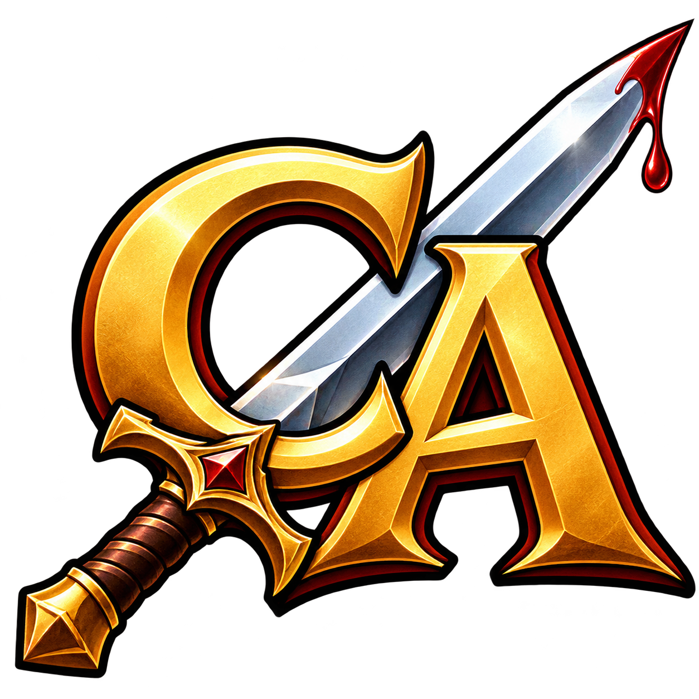

# Clipboard Avenger

**Version 1.0.2 · Windows · Source only**



A Windows system tray app written in Rust that makes clipboard images smaller before you paste them. It works locally, with no network connections or image uploads.

This repository contains the Rust source, build files, and icon assets. **No prebuilt EXE is provided. You must build the app yourself on Windows** using the instructions below.

Choose PNG, JPG, WEBP, or Same as Source under Compression. JPG is the default. The app replaces an image only when the result is strictly smaller, and never overwrites source files. Images paste as file attachments, including in Discord.

Version 1.0.2 includes native bitmap clipboard support for painting apps alongside compressed file attachments. It also includes the Turn On / Turn Off tray action, left-click toggling, selectable compression, resizing, saved copies, and Windows startup settings.

## Features and defaults

Left-click the tray icon to turn watching ON or OFF. OFF uses a darker version of the icon; ON restores the original artwork. Right-click to change settings. Settings save immediately and restore on the next launch, including the matching icon. These defaults apply when no INI file is present:

| Setting | Options | Default |
| --- | --- | --- |
| Clipboard watching | Turn Off / Turn On (action, no checkmark) | ON |
| Compression | PNG, JPG, WEBP, Same as Source | JPG |
| Resize | Don't, 75%, 50%, 25% | Don't |
| Compression → JPEG quality | 50%–100%, in 5% steps | 95% |
| Save Original | Keep an extra copy of the source image | OFF |
| Save Avenged | Keep an extra copy of a smaller processed image | OFF |
| Start with Windows | Launch when you sign in | OFF |

Compression appears above Resize. Its four format choices are followed by a separator and the JPEG quality submenu. Lower JPEG quality means stronger JPG compression; the percentage is not a promised reduction in file size. PNG and WEBP use lossless compression, independent of JPEG quality. Same as Source retains the detected input format (raw Windows bitmaps use BMP). Transparency is preserved: JPG and alpha-unsafe source formats fall back to PNG, and high-depth transparent images use PNG rather than reducing their alpha to WebP's 8 bits. Resize scales both dimensions; Don't preserves the original dimensions.

- Text and non-image clipboard content are ignored. Mixed file selections retain non-image files and images that do not shrink.
- Multiple copied image files are supported. Animated files are skipped to preserve animation.
- A single image also offers standard Windows bitmap formats for painting apps, alongside the compressed file attachment. The bitmap represents the processed image, including its resized dimensions and transparency.
- A single scan runs at a time, recent scanned content is cached, and clipboard changes during processing cancel replacement of the old selection.
- Only one app instance runs at a time. Exit quits the current session without changing the saved startup preference.

## Build and run

Prerequisites: Windows, Rust's MSVC toolchain, and the Visual Studio C++ Build Tools with the Windows SDK installed.

Clone this repository, or select **Code → Download ZIP** and extract the source. Open a terminal in the folder containing `Cargo.toml`, then run:

```powershell
cargo test --locked
cargo build --release --locked
```

Run the EXE you built at `target\release\clipboard-avenger.exe`. It appears in the system tray, possibly under the overflow arrow. The icon is embedded during the build. You can copy your built EXE to another folder before enabling Start with Windows.

## Settings and saved images

| Data | Location |
| --- | --- |
| Settings | `%LOCALAPPDATA%\Clipboard Avenger\settings.ini` |
| Activity log | `%LOCALAPPDATA%\Clipboard Avenger\activity.log` |
| Clipboard working copies | Your Windows Pictures folder, under `Clipboard Avenger\Clipboard` |
| Optional saved copies | `Saved` beside the executable, or the folder selected through **Save → ...** |

Original and avenged archive copies share the same folder, with `original-` and `avenged-` filename prefixes. Encoded originals are copied untouched; raw clipboard bitmaps are saved as PNG. Save Avenged archives only results that are smaller than the source.

If the chosen custom folder cannot be written to, the app silently falls back to `Saved` beside the executable for that copy. It counts one failure per image save batch. After ten failed attempts, it clears the custom folder setting. The failure count persists across restarts and resets when another folder is chosen. Save failures do not interrupt clipboard processing.

Clipboard working copies are separate from optional saved copies and are retained so later pastes and clipboard history can still refer to them. Removing a working copy can make an older paste unavailable.

Start with Windows applies only to your Windows account and needs no administrator permission. If you move the executable, run it once from its new location to update the startup path. Existing settings can be migrated from the app's former name, Desktop Image Avenger; see the [full usage notes](README.txt) for details.

## AI disclosure

This project was made entirely with AI, if you have a problem with that. You do you, I'm not remotely pretending I made this. ChatGPT did it entirely by itself. I just directed it.
